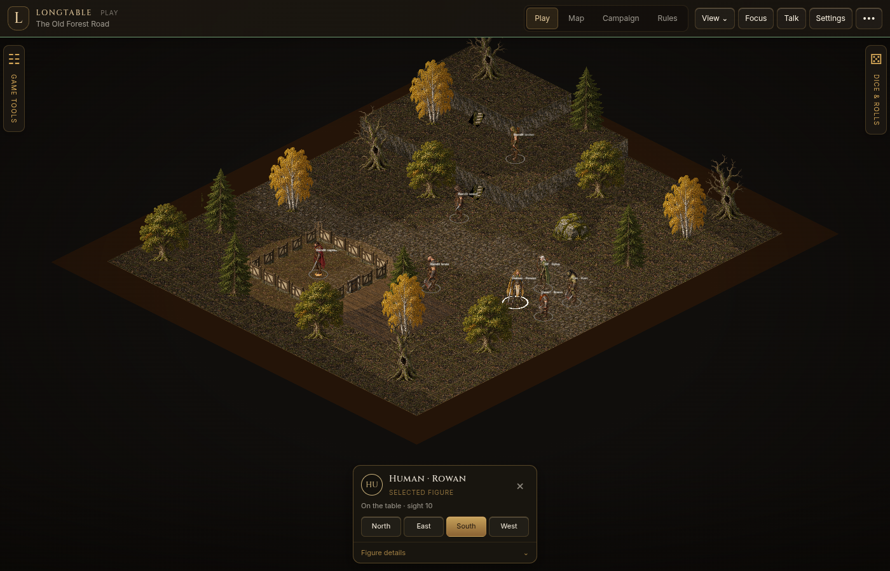

# The Old Forest Road

[View the cabin cutaway in focus mode](milestones/forest-cabin-cutaway.png) or [inspect the stone stairs](milestones/forest-stairs.png).

Open **Edit → Map → Load forest encounter**. This creates a new playable encounter and an editable draft. It keeps the previous scene and its figures in the campaign. Switch to **Play** for the encounter, or keep editing and use **Put on the table** to publish changes.

The road winds past a furnished log cabin, four species of trees, a mossy boulder, and two raised terraces. Both height changes have solid stone treads and landings: the lower path connects tier 0 to 1, and the upper path connects 1 to 2. Four adventurers (Human, Elf, Dwarf, Orc) approach four different bandits. The captain starts inside a seven-by-seven cabin with a bed, writing desk, two barrels and two bookshelves. These are reusable object assets with movement blockers and a clear aisle through the room.

The cabin has full-height log walls and a framed oak door taller than the human figure. The GM can click the door's artwork to open it. During play, selecting a figure inside lowers the room's foreground walls; with no selection, visible occupants determine the cutaway. Edit mode displays the full walls. Characters hidden by fog or GM permissions never gain an outline.

Load a fresh forest encounter after pulling an update to see the revised layout and furnishings. Previously saved scenes keep their existing placements.

The fresh cast includes editable Daggerheart demonstration stats: attacks, damage, thresholds and marked HP. A campaign without a chosen rules system starts using Daggerheart; an existing rules choice is preserved. These are showroom builds, not official adversary stat blocks.

## Paint a woodland

Select **Ancient woodland** under Biomes. Brush paints a continuous stroke and places spaced trees; Bucket fills the connected ground region; Whole map fills the draft. Variant selection is deterministic, and repeated biome painting respects existing objects. For an unobstructed path, choose **Old cobbled road** under Ground and paint with a wide brush. Forest and road edges blend organically; cabin boards stay crisp.

Walls support freehand, straight line, and rectangular room gestures. Drag a room perimeter, then choose a door and click the edge where it belongs. Height painting offers Ground, Step and Rise. Add stairs between adjacent cells exactly one tier apart.

## Add a sheet to the library

Use **Map → Import sheet**. Choose the category and cell dimensions, preview the cuts, then add it. Props use one asset per cell; cast uses four columns per row (north, east, south, west); wall rows use two axes; door rows use four axis/state frames. This is a regular-grid importer, so keep titles, borders and decorative guide labels out of your production sheets.

Try `docs/examples/forest-floor-sheet.png`: four 128×128 cells, zero margin and gutter, Ground category, grouped as variants. Use a new pack ID. The importer creates and validates the pack, then adds it to the same asset library used by painting and placement. The dialog includes a downloadable guide; [the full asset contract](assets.md) covers collision, pivots, scale and layers.

## Light the encounter

Open **Lighting** in Play to switch between Day, Dusk and Night or adjust ambient brightness. The sample includes warm flickering torchlight in the cabin and cold blue magic on the terrace. **Map → Lights** adds Torch, Magic or Steady sources with adjustable color, reach and intensity. See [the lighting guide](lighting.md).

Open **Sounds** to try female and male combat voices: Attack, Exertion, Take damage and Defeat. These play locally, with voice selection, volume, mute and Stop. See [the combat sound guide](combat-sounds.md) for playback and asset credits.

## Workspace controls

Play starts with compact side rails. Open Tools or Dice when needed; click them again to recover map space. Selecting a figure shows a compact summary; expand Details for editing. **F** toggles focus mode while no text field is active. Sheet windows stay within the viewport and scroll internally on small screens. The View menu contains camera and layout controls.

All eight characters have four distinct views. Select a figure and use North, East, South or West in the compact inspector; moving a figure also updates its facing. Facing persists through save and reload.

Try `docs/examples/forest-adventurers-sheet.png` or `docs/examples/forest-bandits-sheet.png` in Import sheet: choose Cast, set cells to **160 × 256**, zero margin/gutter, **128 pixels per world unit**, **1 × 1 footprint**, and foot pivot **80, 245**. The four columns are North, East, South, West; each row becomes one character. Use a new pack ID to preserve the bundled artwork.

The importer expects regular-grid PNG sheets. It does not remove backgrounds or segment arbitrary moodboard collages.

## Select, target and move

Left-click a controllable figure to select it. With a figure selected, click another figure to target it; click that target again to select it if your seat controls it. Transparent space around a sprite passes the click through to figures behind it.

Click clear ground to move the selected figure, or drag it to a destination. Walking follows a route around blocked objects and walls, through open doors and across connected stairs. An unreachable destination leaves the figure in place. The entire footprint must fit; a large figure cannot squeeze through a narrow gap. GM walking follows the same rules.

Right-click a character for the action dial. It shows selection, targeting, character sheet and available rules actions for that character and the selected actor. Right-click ground for **Move here**, **Center view**, and the GM's explicit **Teleport** option. Teleport bypasses the route; use ordinary movement to walk through the scene. Escape or a click outside closes the dial.

Movement animates locally along the route. Reduced-motion preferences keep movement immediate. Rendering reuses scenery, textures, elevation grids and silhouette masks; stationary lighting updates are capped, and hidden tabs stop drawing. See [performance notes](rendering-performance.md) for the measured checks and limits.

## Character animation

All eight characters have newly drawn frames for idle, melee attack, ranged attack, movement, taking damage and spellcasting in all four directions. The pack includes 32 animation sheets containing 768 frames. Right-click a controllable character and open **Animations** to preview each state; previews do not roll dice or change game stats. Walking and combat also trigger animations. Spellcasting currently runs through the preview menu. Reduced-motion preferences hold a still pose.

See [asset size measurements](animation-assets.md) for the before/after count and download size.

## Roll and apply damage

In Daggerheart, attack a targeted character through the action dial. Once the attack dice settle on a hit, **Roll damage** appears directly below the dice. Nothing damages the target until that button is pressed. A miss has no damage button.

The damage result shows the target's thresholds and the HP actually marked. Damage below Major marks 1 HP, meeting Major marks 2, and meeting Severe marks 3; zero damage marks none. Adversaries receive these marks immediately. Critical hits add the maximum of the damage dice, and PCs with available armor can answer the armor prompt. Each successful attack permits one damage roll, including after reconnecting.

## Each player's sight

Select an adventurer, expand **Figure details**, and choose its player under **Owner**. This assigns the linked character sheet, combat actions and all its figures in the campaign's scenes together; changing the sheet's owner does the same. Unlinked figures keep independent owners. Leave vision enabled. A seat sees from its own figures; an unowned figure does not grant everyone sight. The GM can use **View as** to inspect an individual player's view.

Trees, rocks, cabin walls, closed doors and terrain block sight according to their height. Unseen areas are dark; explored areas outside current sight remain dim, including upright scenery. Another player's exploration does not reveal your map. The GM's explicit reveal brush remains shared. Opening the cabin door or moving around an obstacle updates the view, and personal exploration persists when switching scenes or reloading.
