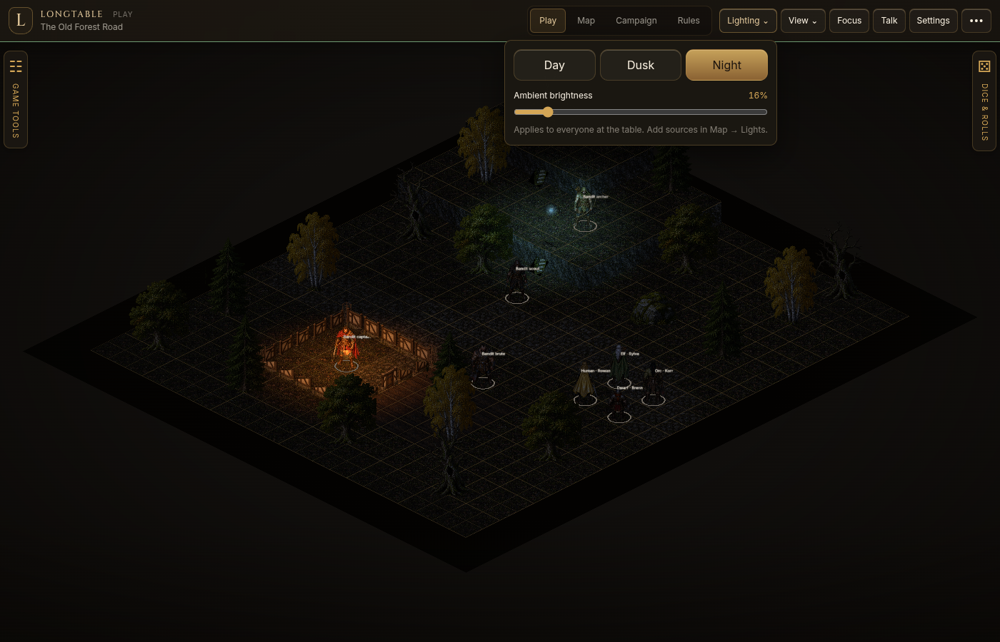

# Lighting the table

Lighting is part of the scene. The GM controls it; every connected seat receives the same settings, and saves preserve them.

## Time of day

Open **Lighting** in the Play toolbar, then choose **Day**, **Dusk**, or **Night**. In Map, the same controls appear under **Environment**. Each preset sets the overall tint and a useful starting brightness. Adjust ambient brightness to make the environment lighter or darker. In Play, changes apply immediately to the current scene. In Map, changes preview in the draft and travel with it when published.

Old maps open in daylight. Changing time of day does not change token visibility, explored fog, or who owns a character.

## Place a light

Open **Map → Lights**, then choose a source:

- **Torch**: golden orange, with a faint, smooth change in brightness and reach.
- **Magic**: cold blue, with a gentle pulse.
- **Steady**: constant illumination in a chosen color.

Set the color, reach and intensity, then click a ground square. Clicking the same square replaces its light. The Erase tool removes it; Undo restores the previous edit. Publish the draft to share the changes with the table.

Lights illuminate the ground, walls, props and character artwork with distance falloff. A source on a raised terrace follows its elevation. Torch movement is intentionally subtle, and reduced-motion preferences keep sources steady. Lighting does not reveal characters hidden by fog or permissions.

## Try the showroom

Load **The Old Forest Road** from Map. It includes warm cabin torchlight and a cool magic source near the raised path. Switch to Night to compare their colors against the woodland, then return to Day without rebuilding the map.

The renderer uses up to 32 nearby sources at once. It computes illumination for the fixed-view artwork; it does not cast physical shadows from the painted sprite silhouettes.
