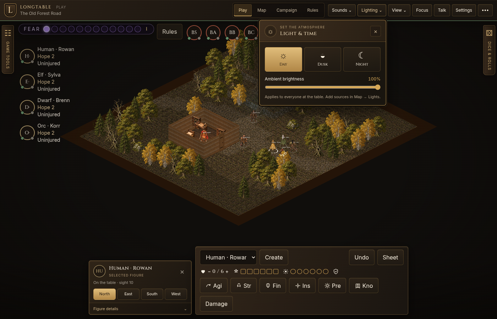

# The table screen

The map fills the window. Tools live at its edges or in movable windows, leaving the playing surface available. The interface uses a field-journal style: dark walnut surfaces, brass frames and controls, parchment text, and restrained shield and compass motifs. Decoration is static and uses CSS or small SVGs rather than extra image textures or continuous effects.

## Regions

- **Top bar.** The current scene and mode, then Play, Map, Campaign, and Rules. View holds zoom, fit, centering, and grid controls. The table menu (•••) holds the party, version, reset, and Leave. A player sees only Play.
- **Left rail.** Opens the tool for the current mode. It starts closed in Play; choosing Map, Campaign, or Rules opens it. Players do not get this dock.
- **Center.** The map. In Play, a Daggerheart table draws Fear, adversary portraits, and the party column over this map. In Design the map is covered by an opaque board: Overview, PC sheet, NPC sheet, and Adversary card. While dice are rolling, the tray sits here.
- **Right rail.** Opens the roll history and dice controls when needed.
- **Bottom strip.** A compact selected-figure card and the character action bar. Figure details expands a scrollable inspector; selecting a figure never automatically expands it. Hidden in Design.

Focus (F) hides the rails and bottom controls to give the scene the full window; F or Escape brings them back. On narrow screens, the drawers overlay the map and only one opens at a time.

A dock panel can collapse, pop out, and be dragged and resized. Settings, Talk, and character sheets are movable windows with their own close controls. Clicking or focusing a floating window brings it to the front. Floating panels stay within the current viewport, including after resizing the browser, and scroll inside their frames. Focus a title bar or resize handle and use arrow keys to move or resize; Shift makes larger steps. A dock's inner edge sets its width. These choices are remembered in this browser under `game-table.layout`. Reset layout closes open popup windows and restores the defaults.

Top-bar menus have a title, context label, and explicit close button. Only one opens at a time; clicking outside, moving focus outside, or pressing Escape dismisses it. Escape closes the foreground menu before affecting windows behind it or Focus mode. When no higher popup is present and no text field is being edited, Escape closes the foremost closable window. Closing by keyboard returns focus to its opener when available.

The action dial uses a brass compass frame, identifies the acting figure, and keeps actions readable around its rim. Dice appear in a framed tray with a close control and a result section. Successful Daggerheart attacks still wait for **Roll damage** below the dice. Short viewports give the tray additional height so this action stays accessible.

Do not place a new control with `fixed` outside these regions. A menu that must cover the screen, the dice tray, a toast, and the lobby are the exceptions, and they use the layers below.

## Layers

From back to front: the map, the docks, a floating panel, a menu, the dice tray, a toast, the lobby.

## Controls

- Body and action text is at least 12px; compact decorative captions can be smaller.
- A button or field is normally at least 32px tall; grouped window controls can be 28px.
- A panel has one primary button. The others stay quiet.
- Three or more choices in a narrow panel are a vertical list, not a row of cramped labels.

## GM modes

Play runs the table. Edit holds Map and Campaign: the map, scenes, and the cast. Design holds Rules. Entering Design loads the campaign's rule set. Load on a system card opens that set, and the center board reads it. PC, NPC, and adversary each have a sheet, and the adversary sheet is a card. The campaign's system is chosen in Campaign, not in Rules.
